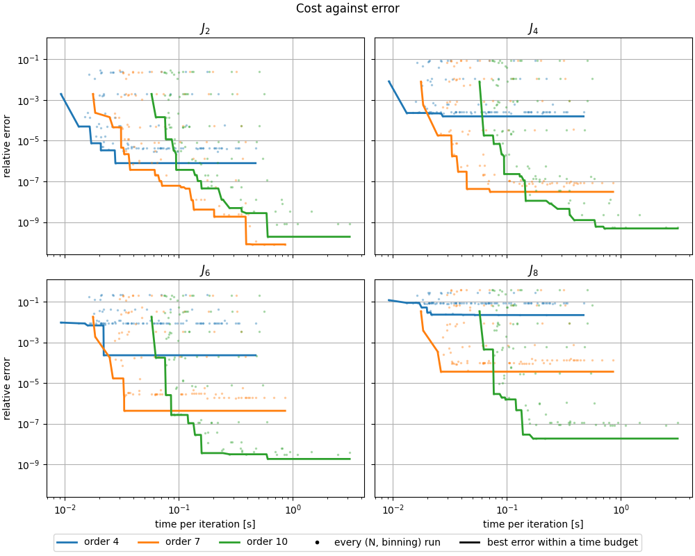

# PyToF
Numerical implementation of the Theory of Figures algorithm (4th, 7th, 10th order) including barotropic differential rotation.

**You are free to use this code for your own work if you cite**

Morf, L., Müller, S., and Helled, R., "The interior of Uranus: Thermal profile, bulk composition, and the distribution of rock, water, and hydrogen and helium", <i>Astronomy and Astrophysics</i>, vol. 690, Art. no. A105, EDP, 2024. doi:10.1051/0004-6361/202450698. 

## Installation

Download or clone this repository, navigate into the directory and execute

```console
pip install .
```

PyToF 2.0 supports Python >= 3.10 (tested on 3.10 to 3.13) and requires numpy >= 1.26 and scipy >= 1.12. matplotlib is only needed for the debug plots (`debug_plot="show"` or `"save"`); install it with `pip install .[plot]`.

## Basic usage

```python
import numpy as np
from scipy.integrate import trapezoid
from PyToF import ToF

X = ToF()                                    # Jupiter, 4th order, N = 1024
X.set_barotrope(lambda P, param: np.sqrt(P)) # rho(P) of a single polytrope
n_iterations = X.relax_to_barotrope()        # Theory of Figures + hydrostatic equilibrium

X.get_Js_errors()
for n in range(1, 5):
    print(f"J_{2*n} = {X.Js[n]:.4e} +/- {X.Js_errors[n]:.1e}")
```

Given an interior density profile instead of a barotrope:

```python
N = 1024
radius, period = 1e6, 24 * 3600
radii = radius * np.linspace(1, 1e-3, N)     # outer surface first
densities = 1000 * np.ones(N)                # kg/m^3
mass = -4 * np.pi * trapezoid(densities * radii**2, radii)

X = ToF(N=N, M_phys=mass, R_phys=[radius, "mean"], Period=period, order=4)
X.li, X.rhoi = radii, densities
X.m_rot_calc = (2 * np.pi / period) ** 2 * X.li[0] ** 3 / (X.opts["G"] * mass)
X.relax_to_shape()
```

All options are listed with their defaults in the table printed by `PyToF.options.Options.describe()`.

## Tutorial

The folder `tutorial/` contains five notebooks that explain all functionalities, in this order:

1. [`01_first_model`](tutorial/01_first_model.ipynb): create a planet, relax it, read the results, accuracy estimates
2. [`02_plotting`](tutorial/02_plotting.ipynb): profiles, 2D shape, figure functions, comparing models (plain matplotlib)
3. [`03_your_own_planet`](tutorial/03_your_own_planet.ipynb): physical parameters, density profiles, atmospheres, density jumps, tuning to measured moments
4. [`04_beyond_the_Js`](tutorial/04_beyond_the_Js.ipynb): moment of inertia, Love numbers, differential rotation
5. [`05_numerics_guide`](tutorial/05_numerics_guide.ipynb): order, grid size, binning, tolerances, warnings, debugging

The notebooks need the `matplotlib` extra (`pip install .[plot]`).

## Accuracy and Convergence

Everything is checked by one notebook, [`accuracy/accuracy.ipynb`](accuracy/accuracy.ipynb). The variable `MODE` in its first code cell (or the environment variable `ACCURACY_MODE`) selects

* `"quick"` (~10 s): analytical checks, small N sweep, DR2, comparison with the shipped tables;
* `"full"` (default, ~4 min on 20 cores): all orders, N = 2^3..2^15, binning, Simpson and trapezoid, DR2/DR3, Movshovitz & Fortney; it regenerates the figures in `accuracy/images/`.

It compares PyToF with exact solutions (moment of inertia of three bodies, Love functions of Gavrilov et al. 1976 and of a two-layer planet), with the Bessel-function solution of the rotating n=1 polytrope of

Wisdom, J. and Hubbard, W. B., "Differential rotation in Jupiter: A comparison of methods", <i>Icarus</i>, vol. 267, pp. 315-322, 2016. doi:10.1016/j.icarus.2015.12.030,

with their CMS results for differential rotation, and (full) with the code of Movshovitz, N. and Fortney, J. J., <i>The Planetary Science Journal</i>, vol. 3, Art. no. 88, 2022. doi:10.3847/PSJ/ac60ff. All literature numbers are in [`accuracy/references.py`](accuracy/references.py). The notebook also recomputes the error tables behind `get_Js_errors()` (`PyToF/accuracy_data_*.npz`) and compares them with the shipped ones. Figures go to `accuracy/images/`.

### Convergence with N and order

Relative difference to the Bessel solution (dashed: Movshovitz & Fortney 2022) and run time:


### Binning

Error as a function of N and the binning N / n_bin; binning by a modest factor costs no accuracy and saves time:


### Cost against accuracy



## Changelog

See [`CHANGELOG.md`](CHANGELOG.md) (2.0.0: MCMC and `PlotToF` removed, renamed options with `RenamedWarning`, new tutorials and tests).
