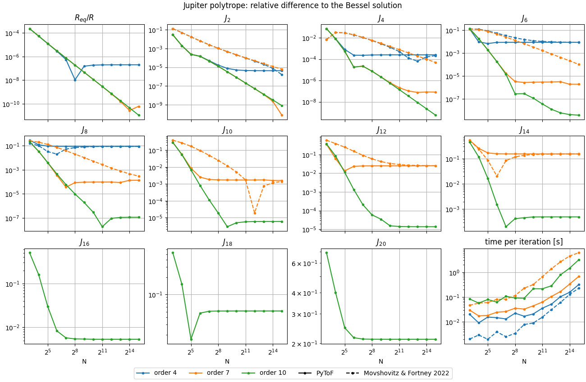
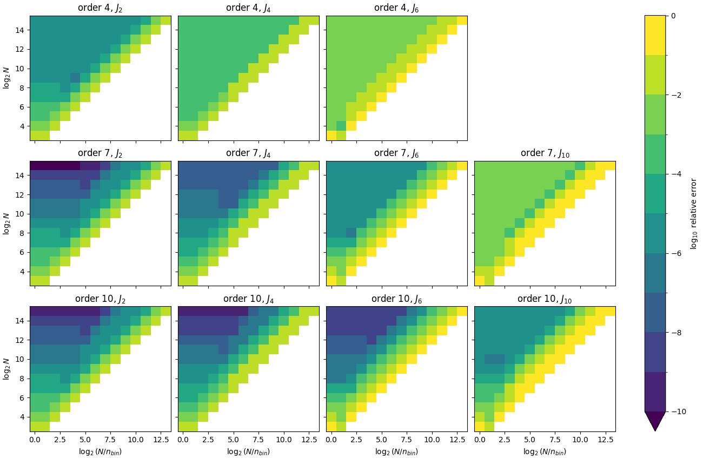

# PyToF
Numerical implementation of the Theory of Figures algorithm (4th, 7th, 10th order) including barotropic differential rotation.

**You are free to use this code for your own work if you cite**

Morf, L., Müller, S., and Helled, R., "The interior of Uranus: Thermal profile, bulk composition, and the distribution of rock, water, and hydrogen and helium", <i>Astronomy and Astrophysics</i>, vol. 690, Art. no. A105, EDP, 2024. doi:10.1051/0004-6361/202450698. 

## Installation

Download or clone this repository, navigate into the directory and execute

```console
pip install .
```

PyToF 2.0 supports Python >= 3.10 (tested on 3.10 to 3.13) and requires numpy >= 1.26 and scipy >= 1.12. matplotlib is only needed for the debug plots (`debug_plot="show"` or `"save"`); install it with `pip install .[plot]`.

## Basic usage

```python
import numpy as np
from scipy.integrate import trapezoid
from PyToF import ToF

X = ToF()                                    # Jupiter, 4th order, N = 1024
X.set_barotrope(lambda P, param: np.sqrt(P)) # rho(P) of a single polytrope
n_iterations = X.relax_to_barotrope()        # Theory of Figures + hydrostatic equilibrium

X.get_Js_errors()
for n in range(1, 5):
    print(f"J_{2*n} = {X.Js[n]:.4e} +/- {X.Js_errors[n]:.1e}")
```

Given an interior density profile instead of a barotrope:

```python
N = 1024
radius, period = 1e6, 24 * 3600
radii = radius * np.linspace(1, 1e-3, N)     # outer surface first
densities = 1000 * np.ones(N)                # kg/m^3
mass = -4 * np.pi * trapezoid(densities * radii**2, radii)

X = ToF(N=N, M_phys=mass, R_phys=[radius, "mean"], Period=period, order=4)
X.li, X.rhoi = radii, densities
X.m_rot_calc = (2 * np.pi / period) ** 2 * X.li[0] ** 3 / (X.opts["G"] * mass)
X.relax_to_shape()
```

## Options

All options are keyword arguments of `ToF(...)` and are stored in `X.opts`. Unknown names raise an error. The table is generated from `PyToF.options.Options.describe()`:

<!-- options:start (generated by tests/make_readme.py) -->

| group | option | default | description |
|---|---|---|---|
| numerics | `N` | `1024` | Number of level surfaces, i.e. grid points: the nested surfaces of constant density into which the planet is divided, each labelled by its mean radius (`ToF.li`). |
| numerics | `n_bin` | `-1` | Number of bins for the figure functions; -1 or N means no binning, positive values smaller than N are faster but less accurate. |
| numerics | `order` | `4` | Theory of Figures order: 4, 7 or 10. Higher orders are slower and more accurate. |
| numerics | `use_simpson` | `True` | PyToF uses Simpson's rule (otherwise the trapezoid rule) for internal integral calculations if True. PyToF falls back to the trapezoid rule on its own if Simpson's rule becomes unstable, see `ToF.simpson_in_use`. |
| numerics | `surface_exponent_warn` | `0.9` | Warn if the density near the surface behaves like (R - r)^n with n below this value (an infinite slope at the surface, e.g. a polytrope with index n < 1), because Simpson's rule may then converge slowly, see the tutorial on numerics. The exponent is estimated from the three outermost grid points in the third iteration of `relax_to_barotrope()` / `relax_to_density()`; it is slightly below the true n (`0.86` for n = `0.8`), so the default `0.9` flags n of about `0.85` and below. 0 switches the check off. |
| numerics | `simpson_check` | `True` | If True, PyToF gives up Simpson's rule for the trapezoid rule when it produces a non-monotonic enclosed mass or pressure (see `ToF.simpson_in_use`). If False, Simpson's rule stays in use whatever happens, which is meant to see where it fails in the debug plots. |
| numerics | `dJ_tol` | `1e-10` | Relative tolerance of the gravitational moments to quantify convergence. |
| numerics | `drot_tol` | `1e-10` | Relative tolerance of the rotational parameter to quantify convergence. |
| numerics | `drho_tol` | `1e-10` | Relative tolerance of the densities to quantify convergence. |
| numerics | `max_iter_relax_shape` | `100` | Maximum number of iterations of `relax_to_shape()`. One iteration is one full pass of the Theory of Figures algorithm. |
| numerics | `max_iter_relax_barotrope` | `100` | Maximum number of iterations of `relax_to_barotrope()`. Each iteration includes up to two passes of the Theory of Figures algorithm and up to `max_iter_density_update` density updates. Must be an integer >= 2. |
| numerics | `max_iter_relax_density` | `100` | Maximum number of iterations of `relax_to_density()`. Each iteration includes up to two passes of the Theory of Figures algorithm and up to `max_iter_density_update` density updates. Must be an integer >= 2. |
| numerics | `max_iter_density_update` | `100` | Maximum number of iterations of the inner density update that runs once per iteration of `relax_to_barotrope()` and `relax_to_density()`. It repeats the update of the densities (relevant if a barotrope or an atmosphere model are supplied) until they change by less than `drho_tol`. Must be an integer >= 2. |
| output | `verbosity` | `0` | How much PyToF prints; warnings are always issued. 0: quiet; 1: one summary line per iteration; 2: also timings, the atmosphere transition and the boundary conditions of the Love number calculation; 3: also one line per iteration and every renormalization of radius and mass. |
| output | `debug_plot` | `False` | Draw one debug figure per iteration of `relax_to_barotrope()` / `relax_to_density()` and one per iteration of the Theory of Figures algorithm (very slow, needs matplotlib). 'show' displays them (e.g. in a notebook), 'save' (or True) writes PNG files into the current working directory, False draws nothing. |
| output | `debug_primed` | `False` | Which volume integrals the debug figure of the Theory of Figures algorithm shows: the unprimed `S_2j` (False) or the primed S'_2j (True). |
| planet | `G` | `6.673848e-11` | Gravitational constant in SI units. |
| planet | `M_phys` | `1.8982532431065258e+27` | Mass of the planet in SI units (Jupiter by default). |
| planet | `R_phys` | `[71492000, 'equatorial']` | Physical radius in SI units and its kind: [value, 'equatorial' \| 'mean' \| 'polar'] (Jupiter by default). |
| planet | `R_ref` | `None` | Reference radius for the definition of the Js in SI units; defaults to the value in `R_phys`. |
| planet | `Period` | `35729.699778131784` | Rotation period in SI units (Jupiter by default). |
| planet | `P0` | `0` | Surface pressure in SI units. |
| planet | `alphas` | `array of length 12` | Barotropic differential rotation parameters in m^2 s^-2 (typically ~1e5; much smaller values have no visible effect). |
| model | `baro_param` | `None` | Parameters of the barotrope set via `set_barotrope()`: the barotrope is called as f(P, `baro_param`). Any object, e.g. a number or a list. |
| model | `use_atmosphere` | `False` | Use an atmospheric model for the outermost densities. |
| model | `atmosphere` | `None` | Function atmosphere(`mean_level_surface`, pressure) returning the density of the atmospheric model. |
| model | `atmosphere_until` | `None` | Pressure in SI units at which the atmospheric model may end earliest. |
| model | `H` | `0.0` | WORK IN PROGRESS |

<!-- options:end -->

## Tutorial

The folder `tutorial/` contains five notebooks that explain all functionalities, in this order:

1. [`01_first_model`](tutorial/01_first_model.ipynb): create a planet, relax it, read the results, accuracy estimates
2. [`02_plotting`](tutorial/02_plotting.ipynb): profiles, 2D shape, figure functions, comparing models (plain matplotlib)
3. [`03_your_own_planet`](tutorial/03_your_own_planet.ipynb): physical parameters, density profiles, atmospheres, density jumps, tuning to measured moments
4. [`04_beyond_the_Js`](tutorial/04_beyond_the_Js.ipynb): moment of inertia, Love numbers, differential rotation
5. [`05_numerics_guide`](tutorial/05_numerics_guide.ipynb): order, grid size, binning, tolerances, warnings, debugging

The notebooks need the `matplotlib` extra (`pip install .[plot]`).

## Accuracy and Convergence

Everything is checked by one notebook, [`accuracy/accuracy.ipynb`](accuracy/accuracy.ipynb). The variable `MODE` in its first code cell (or the environment variable `ACCURACY_MODE`) selects

* `"quick"` (~10 s): analytical checks, small N sweep, DR2, comparison with the shipped tables;
* `"full"` (default, ~4 min on 20 cores): all orders, N = 2^3..2^15, binning, Simpson and trapezoid, DR2/DR3, Movshovitz & Fortney; it regenerates the figures in `accuracy/images/`.

It compares PyToF with exact solutions (moment of inertia of three bodies, Love functions of Gavrilov et al. 1976 and of a two-layer planet), with the Bessel-function solution of the rotating n=1 polytrope of

Wisdom, J. and Hubbard, W. B., "Differential rotation in Jupiter: A comparison of methods", <i>Icarus</i>, vol. 267, pp. 315-322, 2016. doi:10.1016/j.icarus.2015.12.030,

with their CMS results for differential rotation, and (full) with the code of Movshovitz, N. and Fortney, J. J., <i>The Planetary Science Journal</i>, vol. 3, Art. no. 88, 2022. doi:10.3847/PSJ/ac60ff. All literature numbers are in [`accuracy/references.py`](accuracy/references.py). The notebook also recomputes the error tables behind `get_Js_errors()` (`PyToF/accuracy_data_*.npz`) and compares them with the shipped ones. Figures go to `accuracy/images/`.

### Convergence with N and order

Relative difference to the Bessel solution (dashed: Movshovitz & Fortney 2022) and run time:



### Binning

Error as a function of N and the binning N / n_bin; binning by a modest factor costs no accuracy and saves time:



### Cost against accuracy


## Testing

Install the test dependencies (`pip install .[test]`) and run, from the repository root:

```
PYTHONPATH=$PWD pytest
```

`PYTHONPATH` makes sure that this source tree and not an installed PyToF is tested. The run takes about 30 s and prints at its top which optional tests are switched on. The notebook tests (the five tutorials and the quick accuracy notebook, a few minutes, need `nbformat` and `nbclient`) are skipped unless you ask for them:

```
PYTOF_TEST_NOTEBOOKS=1 PYTHONPATH=$PWD pytest
```

A single file or test: `pytest tests/test_love.py`, `pytest -k golden`. The golden files of the regression tests are rewritten with `python -m tests.make_golden` (only after a deliberate change of the numerics), the options table of this README with `python -m tests.make_readme`.

## Changelog

See [`CHANGELOG.md`](CHANGELOG.md) (2.1.0: `ToF.history`, `get_Kn` tolerances, exceptions instead of asserts; 2.0.0: MCMC and `PlotToF` removed, renamed options with `RenamedWarning`, new tutorials and tests).
