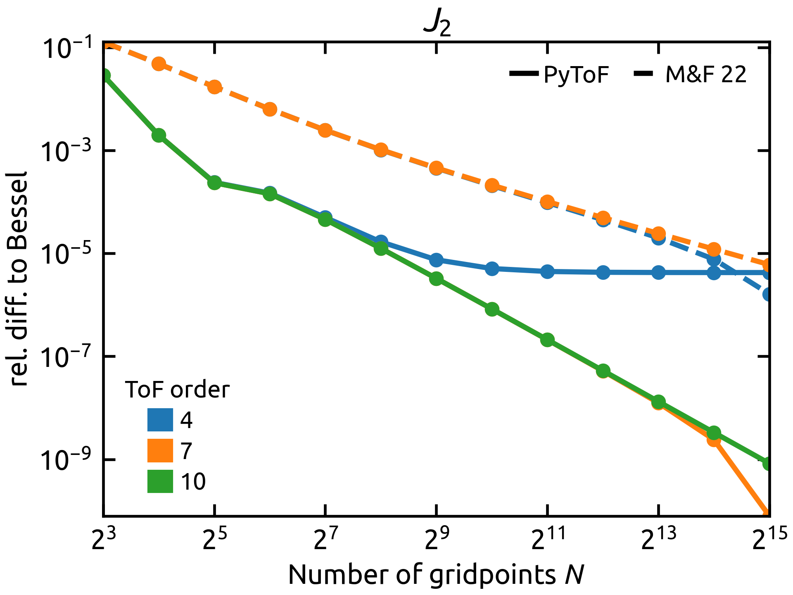
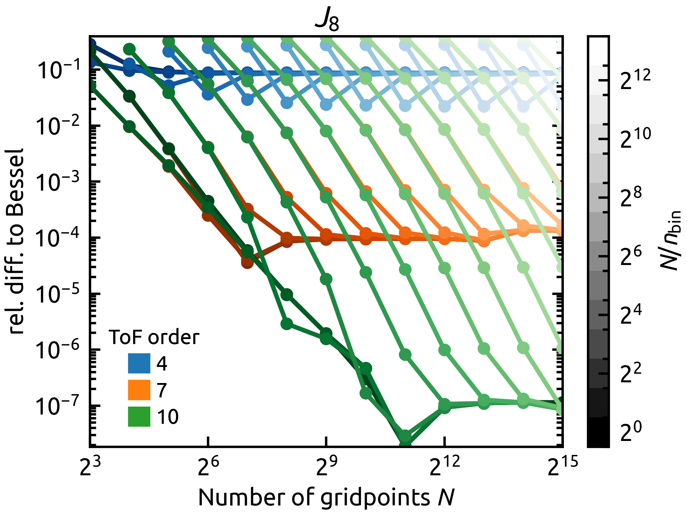
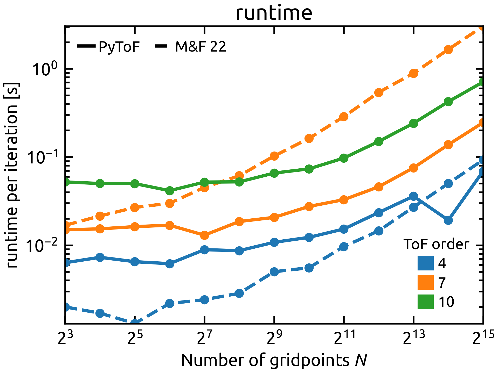

# PyToF
Numerical implementation of the Theory of Figures algorithm (4th, 7th, 10th order) including barotropic differential rotation.

**You are free to use this code for your own work if you cite**

Morf, L., Müller, S., and Helled, R., "The interior of Uranus: Thermal profile, bulk composition, and the distribution of rock, water, and hydrogen and helium", <i>Astronomy and Astrophysics</i>, vol. 690, Art. no. A105, EDP, 2024. doi:10.1051/0004-6361/202450698. 

## Installation

Download or clone this repository, navigate into the directory and execute

```console
pip install .
```

The package requires numpy and scipy. matplotlib is only needed for the debug plots (`debug_plot=True`); install it with `pip install .[plot]`.

Sampling the interior parameters of a planet (MCMC) is not part of PyToF; see the separate package PyToF_MCMC, which uses PyToF as a library.

## Basic usage

```python
import numpy as np
from scipy.integrate import trapezoid
from PyToF import ToF

X = ToF()                                    # Jupiter, 4th order, N = 1024
X.set_barotrope(lambda P, param: np.sqrt(P)) # rho(P) of a single polytrope
n_iterations = X.relax_to_barotrope()        # Theory of Figures + hydrostatic equilibrium

X.get_Js_errors()
for n in range(1, 5):
    print(f"J_{2*n} = {X.Js[n]:.4e} +/- {X.Js_errors[n]:.1e}")
```

Given an interior density profile instead of a barotrope:

```python
N = 1024
radius, period = 1e6, 24 * 3600
radii = radius * np.linspace(1, 1e-3, N)     # outer surface first
densities = 1000 * np.ones(N)                # kg/m^3
mass = -4 * np.pi * trapezoid(densities * radii**2, radii)

X = ToF(N=N, M_phys=mass, R_phys=[radius, "mean"], Period=period, order=4)
X.li, X.rhoi = radii, densities
X.m_rot_calc = (2 * np.pi / period) ** 2 * X.li[0] ** 3 / (X.opts["G"] * mass)
X.relax_to_shape()
```

All options are listed with their defaults in the table printed by `PyToF.options.Options.describe()`.

## Tutorial

The folder `tutorial/` contains five notebooks that explain all functionalities, in this order:

1. [`01_first_model`](tutorial/01_first_model.ipynb): create a planet, relax it, read the results, accuracy estimates
2. [`02_plotting`](tutorial/02_plotting.ipynb): profiles, 2D shape, figure functions, comparing models (plain matplotlib)
3. [`03_your_own_planet`](tutorial/03_your_own_planet.ipynb): physical parameters, density profiles, atmospheres, density jumps, tuning to measured moments
4. [`04_beyond_the_Js`](tutorial/04_beyond_the_Js.ipynb): moment of inertia, Love numbers, differential rotation
5. [`05_numerics_guide`](tutorial/05_numerics_guide.ipynb): order, grid size, binning, tolerances, warnings, debugging

The notebooks need the `matplotlib` extra (`pip install .[plot]`). If a file `mpl_config.py` exists in a folder above the notebooks it is used as matplotlib style; otherwise the defaults apply.

## Plotting

PyToF has no built-in plotting routines; the tutorial shows how to plot the shape and the profiles with plain matplotlib. The option `debug_plot=True` saves diagnostic figures of every iteration into the working directory (slow, for debugging only).

## Accuracy and Convergence

We demonstrate the accuracy of PyToF when compared against 

Wisdom, J. and Hubbard, W. B., "Differential rotation in Jupiter: A comparison of methods", <i>Icarus</i>, vol. 267, pp. 315-322, 2016. doi:10.1016/j.icarus.2015.12.030.

with the plots that are stored in the folder `accuracy/images`. They are generated by [`accuracy/accuracy_full.ipynb`](accuracy/accuracy_full.ipynb) (tens of minutes); [`accuracy/accuracy_quick.ipynb`](accuracy/accuracy_quick.ipynb) (about a minute) runs the analytical checks (moment of inertia, Love numbers), a small version of the convergence study and a check that the error tables used by `get_Js_errors()` are reproducible. Some examples:

### Gravitational moment J2

No binning and compared against Movshovitz, N. and Fortney, J. J., “The Promise and Limitations of Precision Gravity: Application to the Interior Structure of Uranus and Neptune”, <i>The Planetary Science Journal</i>, vol. 3, no. 4, Art. no. 88, IOP, 2022. doi:10.3847/PSJ/ac60ff:



### Gravitational moment J8

With binning and just with the results from PyToF:



### Runtime comparison

No binning and compared against Movshovitz, N. and Fortney, J. J., “The Promise and Limitations of Precision Gravity: Application to the Interior Structure of Uranus and Neptune”, <i>The Planetary Science Journal</i>, vol. 3, no. 4, Art. no. 88, IOP, 2022. doi:10.3847/PSJ/ac60ff:


